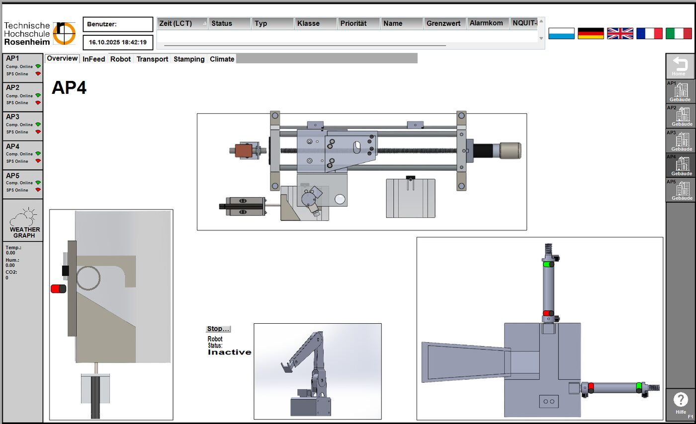
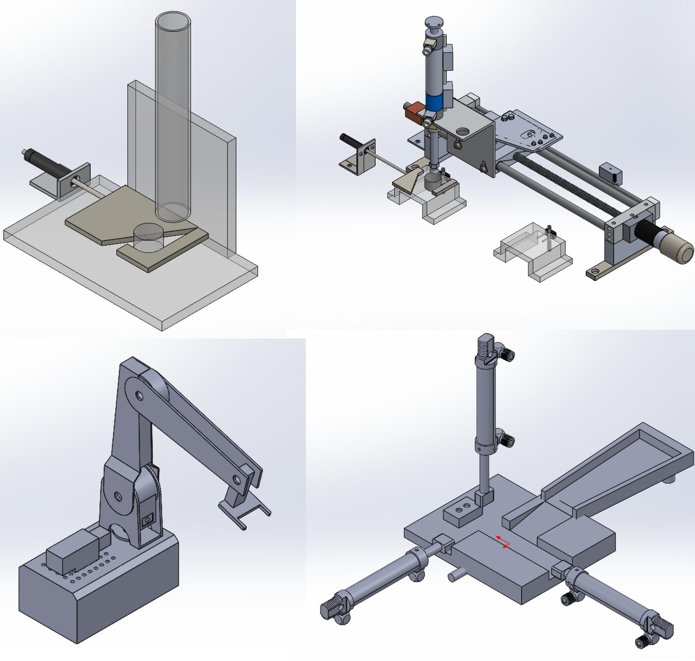

# Digital Twin & Control UI for a Siemens PLC Production Lab (ArchestrA)

**Master's project · TH Rosenheim · 2025**
Team: Agney Jadav, Harshil Faldu, Viraj Vijay Patil · Supervisors: Prof. Dr.-Ing. Franz Perschl, Prof. Dr.-Ing. Peter Crämer

[English](#english) · [Deutsch](#deutsch)

---

## English

### The problem
The Industrial Process Control lab at TH Rosenheim has five identical manufacturing stations run by Siemens PLCs, each with an infeed system, transport system, robotic arm and stamping station. Students could not see the process, so it was hard to connect PLC logic to what the machine was actually doing.

### What we built
A control user interface in **AVEVA ArchestrA IDE** that shows each station as a live, animated digital twin on a touchscreen panel, connected to the PLCs over the **S7 protocol**.

- **CAD visualisation**: built new SolidWorks models of every station and imported them as layered graphics, replacing the old flat drawings
- **Motion scripting**: timer-based scripts and station attributes that move each part of the graphic in step with the real process
- **Robotic arm animation**: motion animated in SolidWorks and integrated via .NET
- **Live PLC data**: inputs and outputs synced to the graphics, with arithmetic converters mapping sensor values to on-screen motion
- **Multi-station overview**: one main screen to switch between all five stations (AP1–AP5) and drill into any one
- **Weather station**: live temperature, humidity and air-quality data from a PLC-connected unit, plotted on screen

### Result
A risk-free training environment that lets students follow the process without standing at the machine, and a reference template for future visualisation exercises in the lab.

### Skills shown
`Siemens PLC` `S7 communication` `SCADA/HMI` `AVEVA ArchestrA` `digital twin` `SolidWorks` `.NET scripting` `process visualisation` `data integration`

---

## Deutsch

### Ausgangslage
Im Labor für industrielle Steuerungstechnik der TH Rosenheim laufen fünf baugleiche Fertigungsstationen mit Siemens-SPS (Zuführung, Transport, Roboterarm, Prägestation). Ohne Visualisierung war der Zusammenhang zwischen SPS-Logik und Prozess für Studierende schwer nachvollziehbar.

### Umsetzung
Eine Bedienoberfläche in **AVEVA ArchestrA IDE**, die jede Station als animierten digitalen Zwilling auf einem Touchpanel darstellt, verbunden über das **S7-Protokoll**.
- Neue SolidWorks-Modelle aller Stationen als Grafiken
- Zeitgesteuerte Skripte, die den realen Prozessablauf abbilden
- Roboterarm-Animation aus SolidWorks, eingebunden über .NET
- Live-Synchronisation mit SPS-Ein- und Ausgängen
- Übersichtsbild für alle fünf Arbeitsplätze (AP1–AP5)
- Live-Daten einer Wetterstation (Temperatur, Feuchte, Luftqualität)
